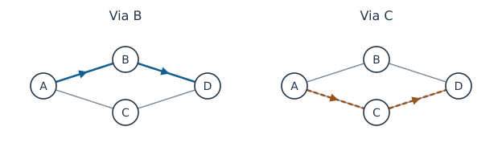

# P-Gure figure description language

P-Gure's v0.1 DSL describes peer-to-peer networks and the messages that travel over them. A document defines one topology. Each view becomes a panel in the same figure, with its own message paths and a shared arrangement of peers.

## One topology, two routes



In both panels the four gray lines show the available links. A filled arrowhead marks each message hop. The author assigns the classes `eager` and `lazy` in the description and chooses their line patterns in Python.

```text
topology Gossip {
    A -- B, C
    B -- D
    C -- D

    A : source
    B, C : relay
    D : destination

    view "Via B" {
        send A -> B -> D : eager
    }

    view "Via C" {
        send A -> C -> D : lazy
    }
}
```

After installing P-Gure, run the following Python from the repository root to reproduce this figure. The input file is [gossip.pgure](gossip.pgure).

```python
from pathlib import Path
from pgure import Stroke, Style, load, render_svg

gossip = load("docs/gossip.pgure")
style = Style(messages={
    "eager": Stroke("#145f91"),
    "lazy": Stroke("#995321", dash="6 3"),
})
Path("gossip.svg").write_text(render_svg(gossip, style=style), encoding="utf-8")
```

## Peers, links, and views

| Statement | Meaning |
| --- | --- |
| `node E` | Declare a peer. An isolated peer appears in every view. |
| `A -- B, C` | Declare undirected links A–B and A–C. Link endpoints implicitly declare their peers. |
| `A -> B` | Declare a directed link from A to B. |
| `A -- B, C : mesh` | Assign the link class `mesh` to both links. |
| `B, C : relay` | Assign the peer role `relay` to B and C. |
| `view "Round 1" { … }` | Add a panel showing the entire topology. |
| `send A -> B -> D : eager` | Draw one path with two hops. Both hops share the message class `eager`. |
| `send A -> B, C : lazy` | Draw two single-hop paths, one from A to B and one from A to C. |

Peer roles, link classes, and message classes have separate namespaces. Each peer can have one role, each link one class, and each message one class. Authors choose these names. A role declaration can precede the peer it references, and a view can precede its links. The parser resolves these references over the entire topology.

Each view starts with an empty list of messages. An empty view shows the base network. If the document omits views, P-Gure supplies one with the topology name as its title. Explicit views appear in declaration order and may share a title. Peer order within a path gives the transmission order. Several sends in a view describe paths to display together and carry no timing information.

## Grammar

A UTF-8 file contains one `topology` block. Quoted terminals are literal tokens. The suffixes `?`, `*`, and `+` mean optional, zero or more, and one or more, respectively.

```ebnf
document   = NL* "topology" id "{" NL* (item (NL+ item)* NL*)? "}" NL* EOF
item       = nodes | role | link | view
nodes      = "node" names
role       = names ":" id
link       = id ("--" | "->") names tag?
view       = "view" string "{" NL* (send (NL+ send)* NL*)? "}"
send       = "send" id "->" id (("->" id)+ | ("," id)+)? tag?
tag        = ":" id
names      = id ("," id)*
```

- Identifiers match `[A-Za-z_][A-Za-z0-9_]*` and are case-sensitive. The four reserved words are `topology`, `node`, `view`, and `send`.
- A string is a double-quoted, single-line Unicode title. The supported escapes are `\"` for a quote and `\\` for a backslash.
- Spaces and tabs separate tokens. Outside strings, `#` starts a comment that extends to the end of the line. `NL` is LF or CRLF. `EOF` is the end of the file. Consecutive statements within a block require a newline. The closing brace may follow the last statement on the same line.
- A send can describe a chain or a fan-out. To show B forwarding a message from A to both C and D, write `send A -> B` and `send B -> C, D` on separate lines.

## Validation and diagnostics

A topology needs at least one peer. Repeated declarations identify the same peer or link. An undirected link is identified by its unordered endpoints. A directed link is identified by its ordered endpoints. A later declaration may supply a missing role or class. Conflicting assignments produce an error.

| Declarations or use | Result |
| --- | --- |
| `A -- B` followed by `send B -> A` in a view | The reverse hop is valid. |
| Only `A -> B` with `send B -> A` | The B→A hop fails. |
| `A -> B` and `B -> A` | Two directed links, each with its own optional class. |
| `A -- B` and `A -> B` | The second declaration fails because both links would cover A→B. |
| `A -- B : mesh` and `B -- A : mesh` | One undirected link. |
| `A -- A` or `A -> A` | Self-links produce an error. |
| `X : relay` or `send A -> X` with undeclared X | The diagnostic points to X. |
| `send A -> B -> D` with no link for B→D | The diagnostic identifies the B→D hop. Each hop must have a direct link in its transmission direction. |

Parsing raises `pgure.DSLError` with the source name, one-based line and column, and the view title for errors inside a view. For example, if line 4 reads `    send A -> B -> D` and the link from B to D is missing, the error points to B at column 15. Use `parse(text, source="experiment.pgure")` for a string or `load(path)` for a UTF-8 file.

## Constructing the same figure in Python

The parser returns a `Topology`. Python callers can build one directly by declaring peers and links before assigning roles and adding views. This example uses the same routes and classifications as the DSL example above.

```python
from pgure import Message, Topology

network = Topology("Gossip")
for a, b in [("A", "B"), ("A", "C"), ("B", "D"), ("C", "D")]:
    network.add_link(a, b)
for peer, role in [("A", "source"), ("B", "relay"), ("C", "relay"), ("D", "destination")]:
    network.set_role(peer, role)
network.add_view("Via B", [Message(("A", "B", "D"), kind="eager")])
network.add_view("Via C", [Message(("A", "C", "D"), kind="lazy")])
```

`network.peers` maps IDs to roles. `network.links` contains the endpoints, direction, and optional class of each link. `network.views` preserves panel order, and each view retains the ordered paths and classes of its messages. A fan-out becomes two or more paths. Multiple messages using the same hop remain separate entries.

## Layout and style

The SVG renderer computes coordinates once from the base topology. It lays out each connected component in breadth-first columns starting from its alphabetically first peer. Peers keep their panel-relative coordinates and scale when views or messages change. An open arrowhead shows link direction and a filled arrowhead shows message direction.

Pass a `Style` to `render_svg` to reuse the same drawing conventions across figures. `peer_fills` maps roles to fill colors. `links` and `messages` map classes to `Stroke` objects with a color and an optional SVG dash pattern. Unmapped classes use their category's default appearance.

The v0.1 output format is SVG. Weights, groups, layers, manual coordinates, external style files, and PDF output are topics for later versions.
