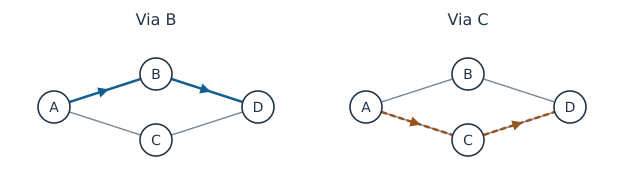
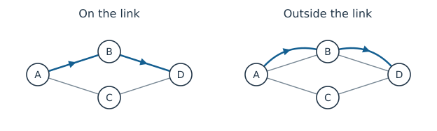

# P-Gure YAML figure format

A UTF-8 YAML document describes one topology. Each view adds a panel that shares the same peers, links, and coordinates. Write the data in a `.yaml` or `.yml` file, or pass the equivalent Python mapping to `from_dict`.

## One topology, two routes



The four links are available in both panels. A message's `path` lists the peers it visits in transmission order. The topology assigns the classes `eager` and `lazy` to the two routes. The companion stylesheet makes the lazy route dashed. [Topology](gossip.yaml) · [Stylesheet](gossip.meta.yaml)

```yaml
name: Gossip
peers:
  - {id: A, role: source}
  - {id: B, role: relay}
  - {id: C, role: relay}
  - {id: D, role: destination}

links:
  - {source: A, target: B}
  - {source: A, target: C}
  - {source: B, target: D}
  - {source: C, target: D}

views:
  - title: Via B
    messages:
      - {path: [A, B, D], kind: eager}
  - title: Via C
    messages:
      - {path: [A, C, D], kind: lazy}
```

From the repository root, render this example with the following Python.

```python
from pgure import load, save_figure

gossip = load("docs/gossip.yaml")
save_figure(gossip, "gossip.svg")
```

## Fields

| Field | Type | Meaning |
| --- | --- | --- |
| `name` | String, required | Topology identifier and default panel title. |
| `seed` | Integer | Master seed for generated groups. Defaults to `0`. |
| `groups` | List of mappings | Each entry generates `n` peers under a unique `id`. Optional fields are `domain`, `params`, and `seed`. |
| `peers` | List of mappings | Each entry has an `id` and an optional `role`. Declare isolated peers here. Link endpoints also declare peers. |
| `links` | List of mappings | Each link has a `source` and `target`. Set `directed: true` for a one-way link. The default is undirected. The optional `kind` selects a link class. |
| `views` | List of mappings | Each view has a string `title` and an optional list of `messages`. Panels appear in list order. Titles may repeat. |
| `messages` entry | Mapping | A `path` of at least two peer IDs is required. The optional `kind` identifies the message class. |

Identifiers, roles, and classes are nonempty printable strings without whitespace. Quote IDs such as `"42"` and `"true"` so YAML reads them as strings. Titles may contain spaces and Unicode text. Use a YAML boolean for `directed`. Field order within mappings is free. Omitted lists default to empty lists.

A topology needs at least one peer. Repeated declarations of a peer or link refer to the same object. Conflicting roles or link classes, self-links, and overlapping directed and undirected links produce errors. Two opposite directed links can have different classes. Each hop in a message must follow a declared link in its transmission direction.

With no views, P-Gure draws the base topology in one panel. With no messages, a view shows the base topology alone. For a fan-out from A to B and C, list two messages with paths `[A, B]` and `[A, C]`. The single path `[A, B, C]` describes B forwarding to C. Messages in one panel have no implied timing relationship.

## Generating networks from a seed

To sketch a network, give a group an ID and a positive node count. This figure contains 20 peers with IDs `P-1` through `P-20`. Its links follow the default Erdős–Rényi (ER) model.

```yaml
name: Sketch
seed: 42
groups: [{id: P, n: 20}]
```

A group's `domain` selects its internal graph model. Each model produces undirected links within that group. Add entries to `groups` to draw independent networks in the same panel. Names are case-insensitive for domains and case-sensitive for group IDs.

| Domain | Model | Parameters and defaults |
| --- | --- | --- |
| `er` | Erdős–Rényi G(n, p) | Each pair connects independently with probability `p` in [0, 1]. The default is `min(1, 3 / max(1, n - 1))`, targeting an expected degree of three where possible. Isolated peers are included. |
| `ws` | Watts–Strogatz | Each peer starts with `k` neighbors on a ring. Each ring-lattice edge is eligible for rewiring with probability `beta` in [0, 1], default `0.1`. Use an even `k` with `0 <= k < n`. The default is the largest such value up to 4. |
| `ba` | Barabási–Albert | Each new peer attaches to `m` existing peers by preferential attachment. Requires `n >= 2` and `1 <= m < n`. Default `m` is `min(2, n - 1)`. |
| `ring` | Cycle | No parameters. A single peer is isolated and two peers share one link. |
| `mesh` | Complete graph | No parameters. Each pair of peers shares one link. |

For example, these two groups have the same number of peers and use different models.

```yaml
name: GeneratedGroups
seed: 42
groups:
  - {id: Sample, n: 10, domain: er, params: {p: 0.32}}
  - {id: Lattice, n: 10, domain: ws, params: {k: 4, beta: 0.25}}
```

The master seed and group ID determine each group's seed. Adding or reordering other groups preserves its internal links. An optional integer `seed` on the group overrides this derivation. To compare parameter values on the same random stream, use the same explicit group seed. For exact reproduction across machines, record the package versions alongside the seeds. P-Gure uses the NetworkX generators. [ER model](https://networkx.org/documentation/stable/reference/generated/networkx.generators.random_graphs.fast_gnp_random_graph.html) · [WS model](https://networkx.org/documentation/stable/reference/generated/networkx.generators.random_graphs.watts_strogatz_graph.html)

Generated peers can receive roles, link classes, and messages through the usual fields. Use the full ID in paths such as `[P-1, P-2]`. Each hop must exist in the generated or explicitly declared links. The renderer labels peers with their local numbers inside the group frame. The SVG retains the full peer IDs.

The same models are available from Python. The returned group records its members, effective seed, and resolved parameters.

```python
from pgure import Topology, save_figure

graph = Topology("Sketch", seed=42)
sample = graph.add_group("Sample", 10, domain="er", params={"p": 0.32})
graph.add_group("Lattice", 10, domain="ws", params={"k": 4, "beta": 0.25})
graph.set_role(sample.members[0], "source")
save_figure(graph, "sketch.svg")
```

## Reading and validating data

Use `load(path)` for a file, `parse(text)` for a YAML string, and `from_dict(data)` for data already assembled by an experiment. All three return the same `Topology` that you can build with `add_peer`, `add_link`, `set_role`, and `add_view`.

```python
from pgure import from_dict

network = from_dict({
    "name": "Exchange",
    "links": [{"source": "client-1", "target": "server-1", "directed": True}],
    "views": [{"title": "Request", "messages": [{"path": ["client-1", "server-1"]}]}],
})
```

Invalid input raises `FigureError`. A data error identifies the field, such as `views[0].messages[1].path[0]` for a failed hop in the second message. YAML diagnostics include the source name and the line and column when available. Unknown fields and duplicate YAML keys are errors.

## Layout and style

For a topology consisting entirely of explicit peers and links, the renderer places each connected component in breadth-first columns from its alphabetically first peer. It computes coordinates once for all panels. An open arrowhead shows link direction and a filled arrowhead shows message direction.

### Group layout

Choose member positions and group arrangement in the companion `.meta.yaml`. Changing these settings preserves the topology. This sheet places the two groups from the previous example side by side.

```yaml
groups:
  arrange: row
  default: {layout: circle}
  ids:
    Sample: {layout: spring}
```

Use `circle` (default) to place peers in member order around a ring, `grid` for a rectangular lattice of positions, or `spring` for a force-directed layout based on internal links and the group's seed. Member layout is independent of the graph model, so a WS group can also use a spring layout. The group-level `arrange` accepts `row`, `column`, or `grid` (default). Frames follow group declaration order. Any peers outside the declared groups share a final frame titled “Other peers”. [Rendered example and source](../examples/README.md#seeded-er-and-ws-networks)

### Message placement



The paths in these two views visit the same peers. Their stylesheet draws the request on the links and the retry on separate arcs. [Topology](message-placement.yaml) · [Placement stylesheet](message-placement.meta.yaml)

### Companion stylesheets

Place `network.meta.yaml` beside `network.yaml` or `network.yml`. Each call to `load` reads the topology and its companion, so reloading after a design edit updates the next render. SVG, PNG, JPEG, and WebP exports all use the resulting style. A topology without a companion uses the built-in appearance.

```yaml
peers:
  default: {fill: white, stroke: "#253544", width: 1.5}
  roles:
    source: {fill: "#173e54", label_color: white}
links:
  default: {color: "#778794", line: solid}
  kinds:
    bridge: {line: "--", width: 2, placement: outside}
messages:
  kinds:
    lazy: {color: "#995321", line: dotted, placement: overlay}
```

Rules inherit individual properties. Built-in values apply first, then the category's `default`, then the matching peer role or link/message kind. In the example, a bridge inherits the default link color and overrides its line pattern and width. Untagged objects and unmatched names use the category default. Each section is optional.

| Section | Select by | Properties |
| --- | --- | --- |
| `peers` | `roles` | `fill` for the interior, `stroke` for the border color, `width` and `line` for the border, `label_color` for the peer ID |
| `links` | `kinds` | `color`, `width`, `line`, `placement` for messages using this link |
| `messages` | `kinds` | `color`, `width`, `line`, `placement` for the message's hops |
| `groups` | `ids` | `layout` for member positions, `fill`, `stroke`, `width`, and `line` for the frame, `label_color` for the group title |

Use SVG color strings and quote hex colors so YAML preserves the leading `#`. Widths are nonnegative numbers in SVG units. The named line patterns are `solid`, `dashed`, `dotted`, and `dash-dot`. Their short forms are `"-"`, `"--"`, `":"`, and `"-."`. For a custom pattern, use a sequence such as `line: [8, 3, 2, 3]` to alternate painted and empty lengths.

To share one stylesheet across files, use `load("network.yaml", meta="themes/paper.meta.yaml")`. An explicit path selects that stylesheet in place of the companion. For a topology constructed in memory, pass `load_style("themes/paper.meta.yaml")` as the `style` argument to `render_svg` or `save_figure`. An explicit `style` argument takes precedence for that render.

#### Placing arrows on links

For each hop, `overlay` draws the message directly on the link centerline. `outside` draws an arc between the same two peers. On straight links the arc bends away from the layout center, or to the right of travel when the center lies on the link axis. On curved links it follows the existing bend.

The renderer checks the message kind, link kind, message default, and link default in that order. The first rule that declares `placement` wins. For the stylesheet above, an unclassified message curves outside only when crossing a bridge. A lazy message follows the centerline even on the bridge.

The fallback is `auto`. Within each view the first automatic use of a link takes the centerline and further uses go outside. An explicit overlay reserves the centerline even when declared later. Outside arcs leave it available. Setting `placement: auto` on a more specific rule restores this behavior.

To migrate an inline `placement`, keep the message's `path` and `kind` in the topology and move the value into `messages.kinds.<kind>` in its companion stylesheet. Use a category's `default` for a figure-wide convention.

## Saving a figure

`save_figure` chooses the format from the filename extension and returns the output path. SVG export is included in the base package. For PNG, JPEG (`.jpg` or `.jpeg`), and lossless WebP, install the raster extra from the repository root.

```sh
python -m pip install -e '.[raster]'
```

```python
save_figure(gossip, "gossip.png", scale=2)
save_figure(gossip, "gossip.jpg", scale=2)
save_figure(gossip, "gossip.webp", scale=2)
```

The Gossip example measures 624 × 188 pixels at its default size and 1248 × 376 at `scale=2`. Use `render_svg(graph)` to get SVG markup as a Python string.
