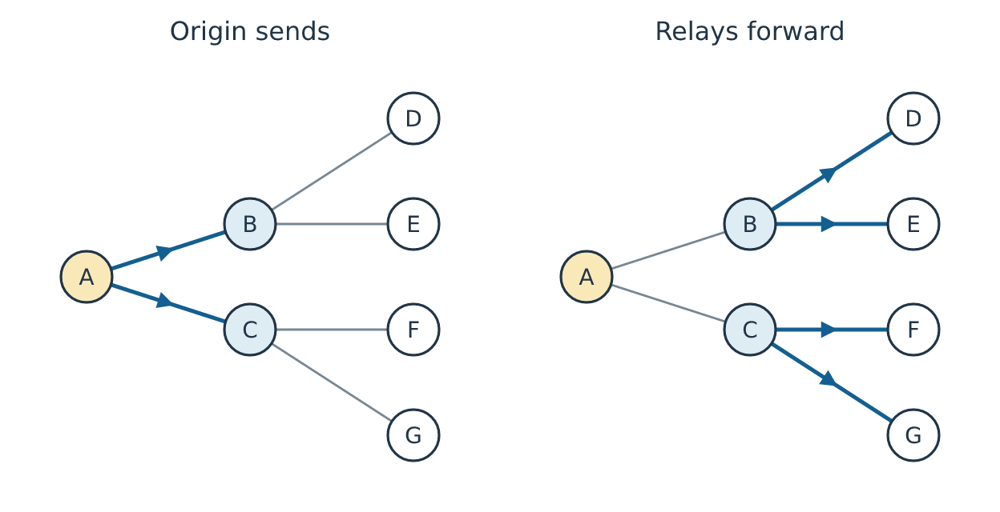
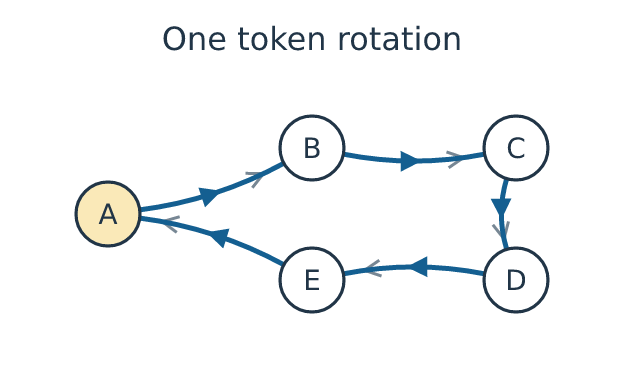
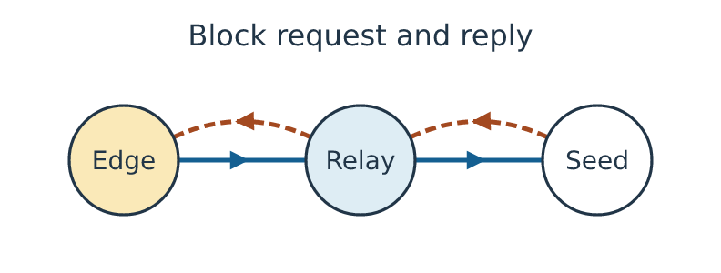
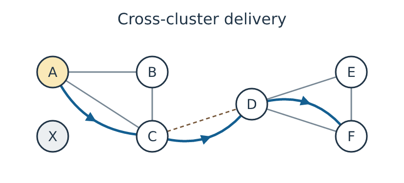

# P-Gure example gallery

These four figures show how peer links and message paths interact. Each entry includes the full YAML, a PNG preview, and an SVG for use in a paper.

## Broadcast in two rounds

A sends the announcement to B and C in the first panel. The second panel shows B forwarding to D and E and C forwarding to F and G. Each recipient has its own message path. The gray links back to A are still available in the second round.



[YAML source](tree-broadcast.yaml) · [Vector figure](tree-broadcast.svg)

<details>
<summary>View YAML</summary>

```yaml
name: Broadcast
peers:
  - {id: A, role: origin}
  - {id: B, role: relay}
  - {id: C, role: relay}

links:
  - {source: A, target: B}
  - {source: A, target: C}
  - {source: B, target: D}
  - {source: B, target: E}
  - {source: C, target: F}
  - {source: C, target: G}

views:
  - title: Origin sends
    messages:
      - {path: [A, B]}
      - {path: [A, C]}
  - title: Relays forward
    messages:
      - {path: [B, D]}
      - {path: [B, E]}
      - {path: [C, F]}
      - {path: [C, G]}
```

</details>

## Token circulation on a directed ring

A hands a token to B. It passes through C, D, and E before returning to A. Every link permits one direction of travel. Repeating A at the end of the path closes the rotation.



[YAML source](directed-ring.yaml) · [Vector figure](directed-ring.svg)

<details>
<summary>View YAML</summary>

```yaml
name: TokenRing
peers:
  - {id: A, role: origin}

links:
  - {source: A, target: B, directed: true}
  - {source: B, target: C, directed: true}
  - {source: C, target: D, directed: true}
  - {source: D, target: E, directed: true}
  - {source: E, target: A, directed: true}

views:
  - title: One token rotation
    messages:
      - {path: [A, B, C, D, E, A], kind: token}
```

</details>

## A block request and its reply

Edge requests a block from Seed through Relay. The solid blue request follows the two link centerlines. The dashed orange reply curves outside those same links as it returns to Edge. Reversing the path sets the reply direction, while its placement keeps both messages visible.



[YAML source](block-exchange.yaml) · [Vector figure](block-exchange.svg)

<details>
<summary>View YAML</summary>

```yaml
name: BlockExchange
peers:
  - {id: Edge, role: origin}
  - {id: Relay, role: relay}

links:
  - {source: Edge, target: Relay}
  - {source: Relay, target: Seed}

views:
  - title: Block request and reply
    messages:
      - {path: [Edge, Relay, Seed], kind: request, placement: overlay}
      - {path: [Seed, Relay, Edge], kind: reply, placement: outside}
```

</details>

## Delivery across a bridge

The triangles A–B–C and D–E–F share one connection, C–D. Follow the blue arrows from A through C and D to F. The dashed bridge stays visible under the outside route. X is declared in the peer list and has no links.



[YAML source](bridged-clusters.yaml) · [Vector figure](bridged-clusters.svg)

<details>
<summary>View YAML</summary>

```yaml
name: BridgedClusters
peers:
  - {id: A, role: origin}
  - {id: X, role: isolated}

links:
  - {source: A, target: B}
  - {source: B, target: C}
  - {source: C, target: A}
  - {source: C, target: D, kind: bridge}
  - {source: D, target: E}
  - {source: E, target: F}
  - {source: F, target: D}

views:
  - title: Cross-cluster delivery
    messages:
      - {path: [A, C, D, F], placement: outside}
```

</details>

## Reproduce the figures

From the repository root, install the raster extra to generate PNG previews alongside the SVGs.

```sh
python -m pip install -e '.[raster]'
```

Run this Python from the same directory. The style gives message origins a pale yellow fill and relays a pale blue fill. The PNGs use twice the width and height of the SVGs.

```python
from pathlib import Path

from pgure import Stroke, Style, load, save_figure

style = Style(
    peer_fills={"origin": "#fae9b8", "relay": "#deedf4", "isolated": "#eceff1"},
    links={"bridge": Stroke("#77583b", dash="4 3")},
    messages={"reply": Stroke("#a34920", dash="6 3")},
)

for source in sorted(Path("examples").glob("*.yaml")):
    graph = load(source)
    save_figure(graph, source.with_suffix(".svg"), style=style)
    save_figure(graph, source.with_suffix(".png"), style=style, scale=2)
```

See the [YAML figure guide](../docs/figure-yaml.md) for the full set of fields.
